
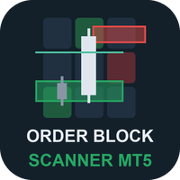

# Displacement Order Block Scanner (MetaTrader 5 and MetaTrader 4)

A scanner indicator that shows, for many symbols and timeframes in one panel on your chart, whether a new displacement
zone appeared, whether price is inside a live zone, or how far the nearest live zone is, and sends an alert when a new
zone or a first test appears.

> **This is a showcase repository: documentation and images only. There is no source code here.** The product is sold on
> the MQL5 Market. The free single-chart indicator that uses the same zone rules has public source:
> [allanninal/displacement-order-blocks](https://github.com/allanninal/displacement-order-blocks).

**Website:** [allanninal.dev/mql5 (indicators)](https://www.allanninal.dev/mql5/#indicators) · [MT4 editions](https://www.allanninal.dev/mql5/#mt4) · [allanninal.dev](https://www.allanninal.dev)
· **Contact:** message me on [LinkedIn](https://www.linkedin.com/in/allanninal/).

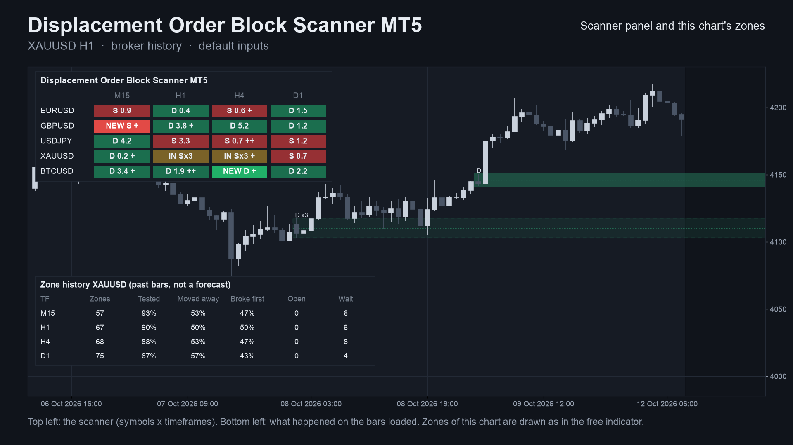

## Get it on the MQL5 Market

| Product | Platform | Price | Link |
|---|---|---|---|
| **Displacement Order Block Scanner MT5** | MT5 | paid | coming soon on the MQL5 Market |
| **Displacement Order Block Scanner MT4** | MT4 | paid | coming soon on the MQL5 Market |
| Displacement Order Blocks (single chart, source on GitHub) | MT5 | free | coming soon on the MQL5 Market |
| Displacement Order Blocks MT4 (single chart, source on GitHub) | MT4 | free | coming soon on the MQL5 Market |

The scanner is standalone: you do not need to install the free indicator to use it. Details, current price and the
Strategy Tester demo will be on the Market pages once they are live.

## What it does

- A panel on the chart with **symbols as rows and timeframes as columns** (default M15, H1, H4, D1; symbols from your
  Market Watch or your own list).
- **In each cell:** `NEW D` or `NEW S` for a zone made in the last 2 closed bars, `TEST D` or `TEST S` for a first test,
  `IN D` or `IN S` (`x2`, `x3` for each entry) while price is inside a live zone. Otherwise the nearest live zone and its
  distance in ATR, for example `D 1.4`.
- A **`+`** when the timeframe to the right has its newest displacement in the same direction, and **`++`** when the zone
  also sits inside a live zone there. It describes agreement, not a promise.
- A **brighter cell** when the event is recent (you choose how many bars count as fresh).
- **Click a cell** to open that symbol and timeframe. A tooltip shows the zone's prices.
- **This chart's zones**, drawn as in the free indicator, with an optional higher timeframe as outlines.
- **Zone history** for the chart's symbol, per timeframe: how many zones the loaded bars produced and what happened to
  them. It describes past bars and is not a forecast.
- **Quality filters** (a gap check and a smallest and largest zone size) and the same zone settings as the free indicator.
- **Alerts:** pop-up (on by default), sound, push notification and e-mail, each switched separately, on new zones and first
  tests (re-entries and broken zones optional, and optionally only when the next higher timeframe agrees). Nothing is sent
  while history loads, never twice for the same cell and bar, and not in the Strategy Tester.
- **Closed bars only.** A cell does not change after its bar has closed. It places no orders.
- Works on any symbol with history, including gold and crypto.

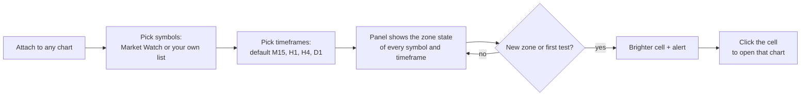

### The grid at a glance

Each cell is one symbol on one timeframe. You read the zone state across the whole list in a single look instead of
flipping through charts.

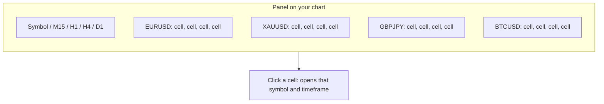

### What a cell can show

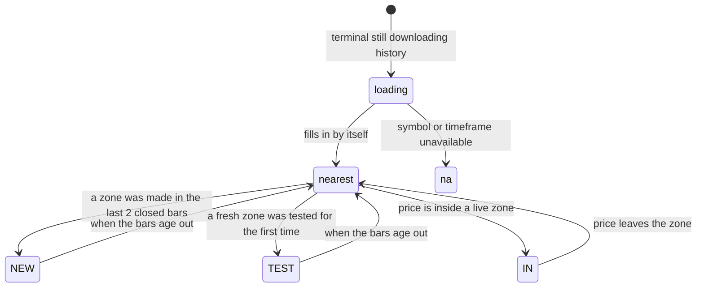

| | |
|---|---|
| 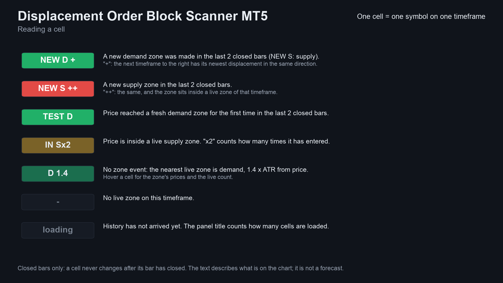 | 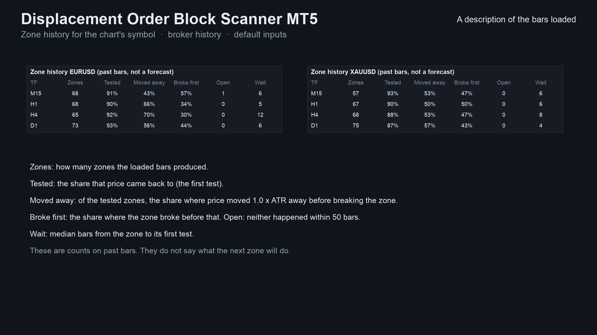 |
| 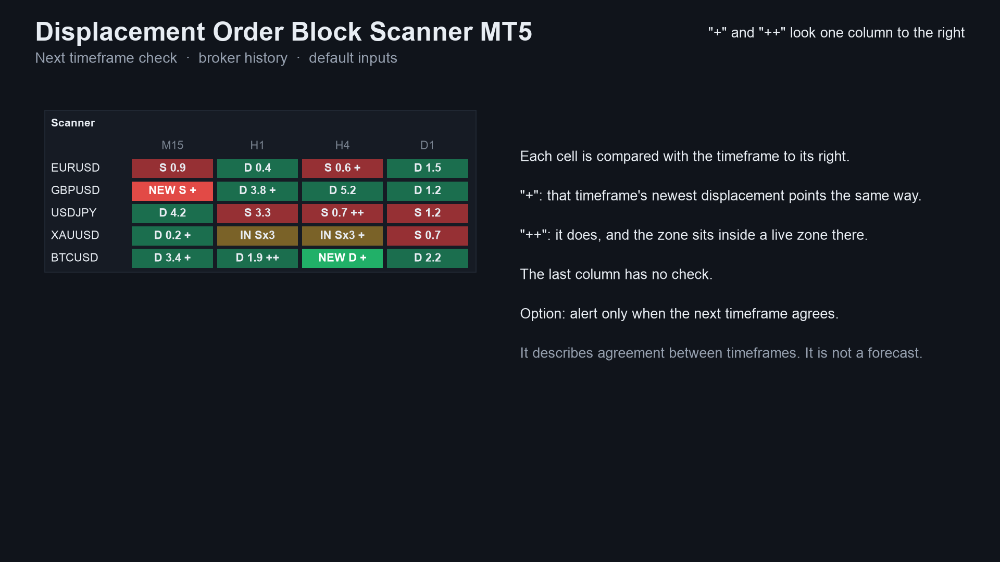 | 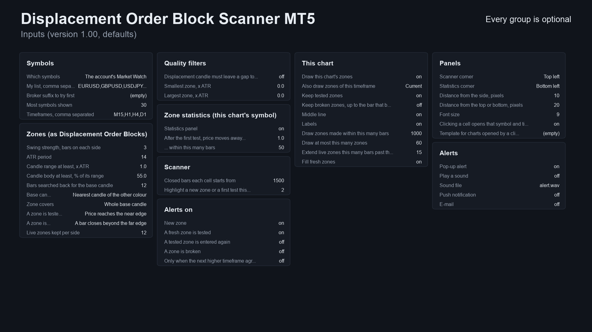 |

MT4 edition screenshots: [panel on a chart](images/mt4/01-scanner-on-chart.png), [how to read a cell](images/mt4/02-reading-a-cell.png),
[zone history](images/mt4/03-zone-history.png). Some screenshots are illustrations built from broker history, not terminal
captures.

## Who it is for

Traders who use displacement zones on several symbols or timeframes. If you watch one chart, the free
[Displacement Order Blocks](https://github.com/allanninal/displacement-order-blocks) indicator draws the same zones on it.

## Why it was built

- The free indicator draws zones on one chart at a time; a trader who follows several symbols has to flip through charts.
- Our October 2026 market research found multi-symbol scanners are a recurring want: scanner and dashboard gigs on Fiverr
  and Upwork run at roughly 45 to 145 USD, and order blocks and supply and demand zones are among the things people ask
  those scanners to show.
- Honest scale of demand: in a scan of 2,014 MQL5 Freelance jobs, 116 were in the SMC / order block group and 26 mention
  an order block. The Market already has many order-block indicators, so this is a careful implementation, not a gap.
- Design rule carried over from the free indicator: trust. Cells use closed bars only, so what you saw does not change.

## How often it makes zones

New zones per month per symbol with the default inputs, closed bars, October 2023 to October 2026. This is a code count,
not a trading result.

| Timeframe | Zones per month (EURUSD) | Zones per month (XAUUSD) |
|---|---|---|
| M15 | about 82 | about 78 |
| H1 | about 21 | about 20 |
| H4 | about 7 | about 6 |
| D1 | about 1 | about 1 |

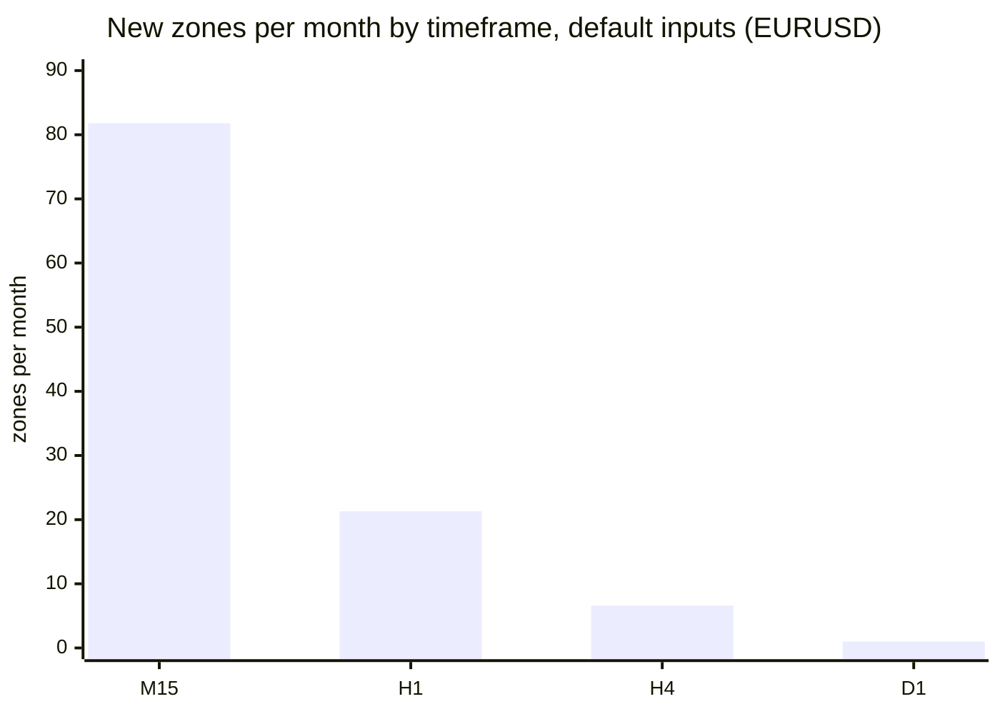

## How it was checked (results)

The zone rules are the ones in the free indicator, and every cell value was compared with an independent Python calculation.

| Check | Result |
|---|---|
| Free indicator, MT5, bar-by-bar buffer comparison | 48 files, 2,022,888 bars, 0 differences |
| Free indicator, MT5, repaint test (EURUSD H1, every tick) | 10.4 million ticks, 0 changed values, 0 events on the live bar |
| Free indicator, MT4, bar-by-bar buffer comparison | 49 files, 1,022,441 bars, 0 differences |
| Scanner, MT5, runs compared with the same calculation | 48 runs (4 symbols x M15 / H1 / H4 x 4 settings), 0 differences |
| Scanner, MT4, runs compared with the same calculation | 51 runs, 0 differences |
| Scanner, MT4, panel counts on every tick checked | matched (28,000 to 46,000 ticks per run) |
| Compared in each scanner run | every zone, state, statistic, cell reading and alert event |

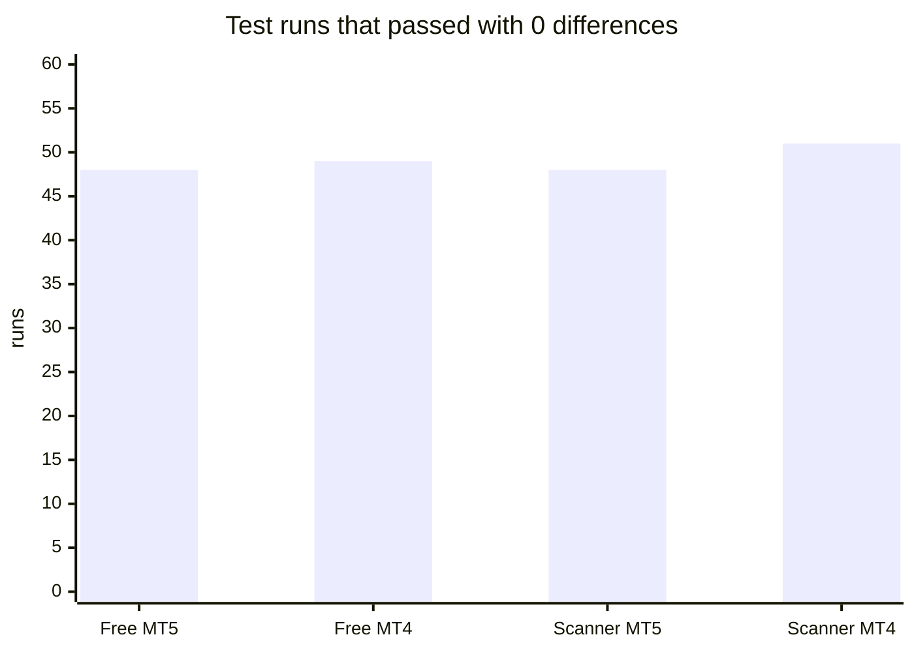

These are code checks, not trading results. Not covered: a live chart on a broker other than the one used for the tests,
and the look of the panel on every screen size.

## Honest limits

- **Zones are descriptive, not predictive.** In a test of the same zone rules against levels placed at random (8 symbols,
  H1 and H4, 2015 to 2026, bid bars, no spread) the zones reacted no meaningfully better than random levels of the same
  size and distance: about 57 % held against about 56 % for the default base candle, and about 61 % against about 60 % for
  the "where the move began" candle, with the difference not repeating reliably across periods. The numbers and method are
  in the [free repository's README](https://github.com/allanninal/displacement-order-blocks#do-the-zones-predict-anything-no-measurably).
  A scanner shows the state of a technical rule. It does not predict the market, and past zones are no indication of future
  results. No profit or accuracy claim is made.
- The zone history panel counts what happened on the bars loaded. What happened to earlier zones does not predict the next one.
- It is an indicator: it places no orders and manages no risk.
- It needs the terminal running to alert, and push needs your MetaQuotes ID set up in the terminal.
- The source is not published; this repository documents what the product does and the results of its checks.

## Free vs paid

| | Displacement Order Blocks (free) | Displacement Order Block Scanner (paid) |
|---|---|---|
| Scope | one chart | many symbols x timeframes in one panel |
| Zones on the chart | current timeframe | this chart, plus an optional higher timeframe |
| Fresh / tested / broken | yes | yes |
| Next timeframe check (+ / ++) | - | yes |
| Zone history for the loaded bars | - | yes |
| Quality filters (gap, zone size) | - | yes |
| Alerts: new zone, first test | yes (this chart) | yes (every symbol in the panel) |
| Click a cell to open that chart | - | yes |
| MT5 | coming soon | coming soon |
| MT4 | coming soon | coming soon |
| Source | [public on GitHub](https://github.com/allanninal/displacement-order-blocks) | not published |

---

**Website:** [allanninal.dev/mql5](https://www.allanninal.dev/mql5/#indicators) · [MT4](https://www.allanninal.dev/mql5/#mt4) · [allanninal.dev](https://www.allanninal.dev)
· Questions: message me on [LinkedIn](https://www.linkedin.com/in/allanninal/). All rights reserved, see [LICENSE](LICENSE).
